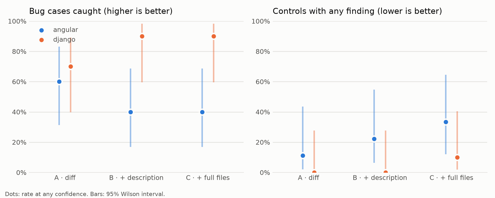
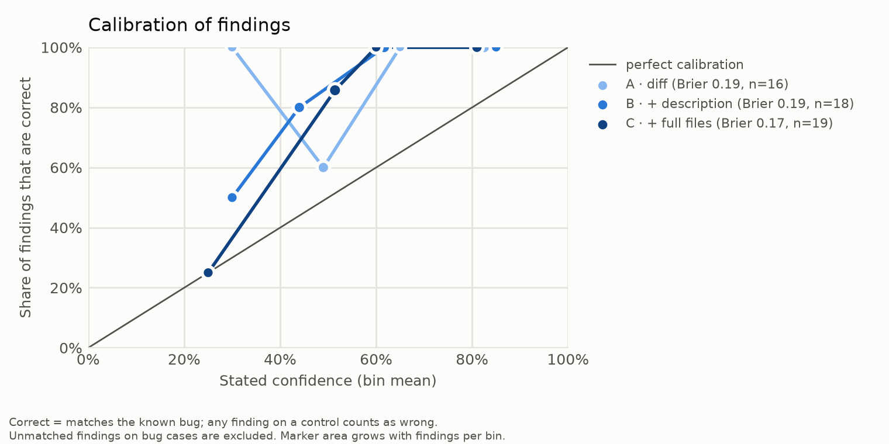

# Results: claude-sonnet-5-5_effort-high

## Detection rate (bug cases)

| repo/condition | conf ≥ 0.0 | conf ≥ 0.5 | conf ≥ 0.8 |
|---|---|---|---|
| all/A | 65% (13/20, CI 43%–82%) | 45% (9/20, CI 26%–66%) | 25% (5/20, CI 11%–47%) |
| all/B | 65% (13/20, CI 43%–82%) | 45% (9/20, CI 26%–66%) | 10% (2/20, CI 3%–30%) |
| all/C | 65% (13/20, CI 43%–82%) | 60% (12/20, CI 39%–78%) | 20% (4/20, CI 8%–42%) |
| angular/A | 60% (6/10, CI 31%–83%) | 40% (4/10, CI 17%–69%) | 20% (2/10, CI 6%–51%) |
| angular/B | 40% (4/10, CI 17%–69%) | 40% (4/10, CI 17%–69%) | 0% (0/10, CI 0%–28%) |
| angular/C | 40% (4/10, CI 17%–69%) | 40% (4/10, CI 17%–69%) | 10% (1/10, CI 2%–40%) |
| django/A | 70% (7/10, CI 40%–89%) | 50% (5/10, CI 24%–76%) | 30% (3/10, CI 11%–60%) |
| django/B | 90% (9/10, CI 60%–98%) | 50% (5/10, CI 24%–76%) | 20% (2/10, CI 6%–51%) |
| django/C | 90% (9/10, CI 60%–98%) | 80% (8/10, CI 49%–94%) | 30% (3/10, CI 11%–60%) |

## False-alarm rate (controls)

| repo/condition | conf ≥ 0.0 | conf ≥ 0.5 | conf ≥ 0.8 |
|---|---|---|---|
| all/A | 5% (1/19, CI 1%–25%) | 5% (1/19, CI 1%–25%) | 0% (0/19, CI 0%–17%) |
| all/B | 11% (2/19, CI 3%–31%) | 0% (0/19, CI 0%–17%) | 0% (0/19, CI 0%–17%) |
| all/C | 21% (4/19, CI 9%–43%) | 5% (1/19, CI 1%–25%) | 0% (0/19, CI 0%–17%) |
| angular/A | 11% (1/9, CI 2%–44%) | 11% (1/9, CI 2%–44%) | 0% (0/9, CI 0%–30%) |
| angular/B | 22% (2/9, CI 6%–55%) | 0% (0/9, CI 0%–30%) | 0% (0/9, CI 0%–30%) |
| angular/C | 33% (3/9, CI 12%–65%) | 11% (1/9, CI 2%–44%) | 0% (0/9, CI 0%–30%) |
| django/A | 0% (0/10, CI 0%–28%) | 0% (0/10, CI 0%–28%) | 0% (0/10, CI 0%–28%) |
| django/B | 0% (0/10, CI 0%–28%) | 0% (0/10, CI 0%–28%) | 0% (0/10, CI 0%–28%) |
| django/C | 10% (1/10, CI 2%–40%) | 0% (0/10, CI 0%–28%) | 0% (0/10, CI 0%–28%) |

## By merge date (all repos, any confidence)

| era/condition | detection | false alarms |
|---|---|---|
| merged 2024+/A | 69% (11/16, CI 44%–86%) | 7% (1/15, CI 1%–30%) |
| merged 2024+/B | 69% (11/16, CI 44%–86%) | 13% (2/15, CI 4%–38%) |
| merged 2024+/C | 69% (11/16, CI 44%–86%) | 20% (3/15, CI 7%–45%) |
| merged before 2024/A | 50% (2/4, CI 15%–85%) | 0% (0/4, CI 0%–49%) |
| merged before 2024/B | 50% (2/4, CI 15%–85%) | 0% (0/4, CI 0%–49%) |
| merged before 2024/C | 50% (2/4, CI 15%–85%) | 25% (1/4, CI 5%–70%) |

## Calibration (all repos)

| condition | findings | Brier | bins (mean conf → accuracy, n) |
|---|---|---|---|
| A | 16 | 0.189 | 0.30→1.00 (3); 0.49→0.60 (5); 0.65→1.00 (2); 0.83→1.00 (6) |
| B | 18 | 0.190 | 0.30→0.50 (4); 0.44→0.80 (5); 0.62→1.00 (6); 0.85→1.00 (3) |
| C | 19 | 0.168 | 0.25→0.25 (4); 0.51→0.86 (7); 0.60→1.00 (3); 0.81→1.00 (5) |

Cases excluded after the run: angular/ctl-56852

Failed reviews (excluded): 0

Spend recorded in this run: $5.33

## Charts

