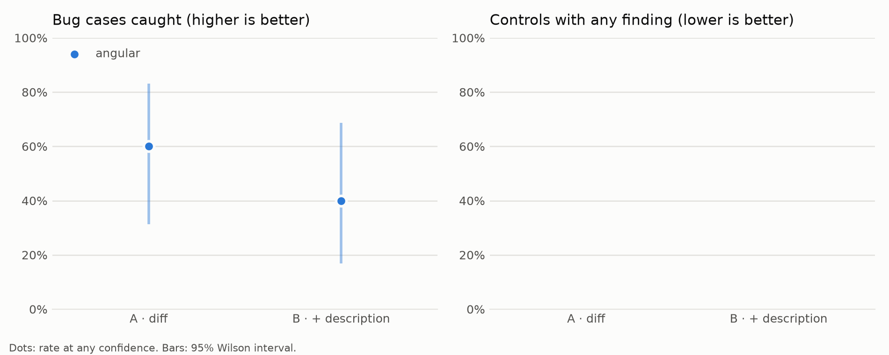
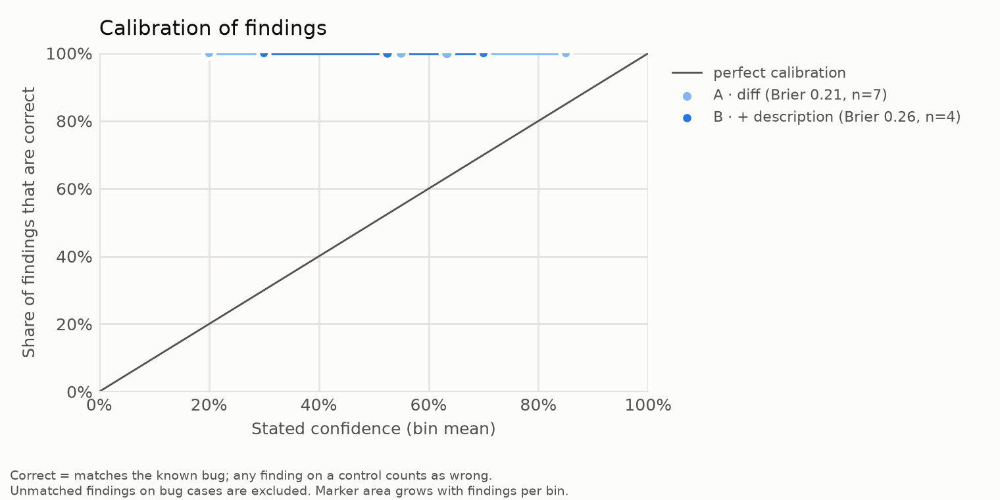

# Results: claude-sonnet-5-5_effort-high_s1

## Detection rate (bug cases)

| repo/condition | conf ≥ 0.0 | conf ≥ 0.5 | conf ≥ 0.8 |
|---|---|---|---|
| all/A | 60% (6/10, CI 31%–83%) | 50% (5/10, CI 24%–76%) | 10% (1/10, CI 2%–40%) |
| all/B | 40% (4/10, CI 17%–69%) | 30% (3/10, CI 11%–60%) | 0% (0/10, CI 0%–28%) |
| angular/A | 60% (6/10, CI 31%–83%) | 50% (5/10, CI 24%–76%) | 10% (1/10, CI 2%–40%) |
| angular/B | 40% (4/10, CI 17%–69%) | 30% (3/10, CI 11%–60%) | 0% (0/10, CI 0%–28%) |

## False-alarm rate (controls)

| repo/condition | conf ≥ 0.0 | conf ≥ 0.5 | conf ≥ 0.8 |
|---|---|---|---|
| all/A | n/a | n/a | n/a |
| all/B | n/a | n/a | n/a |
| angular/A | n/a | n/a | n/a |
| angular/B | n/a | n/a | n/a |

## By merge date (all repos, any confidence)

| era/condition | detection | false alarms |
|---|---|---|
| merged 2024+/A | 67% (4/6, CI 30%–90%) | n/a |
| merged 2024+/B | 33% (2/6, CI 10%–70%) | n/a |
| merged before 2024/A | 50% (2/4, CI 15%–85%) | n/a |
| merged before 2024/B | 50% (2/4, CI 15%–85%) | n/a |

## Calibration (all repos)

| condition | findings | Brier | bins (mean conf → accuracy, n) |
|---|---|---|---|
| A | 7 | 0.211 | 0.20→1.00 (1); 0.55→1.00 (2); 0.63→1.00 (3); 0.85→1.00 (1) |
| B | 4 | 0.258 | 0.30→1.00 (1); 0.53→1.00 (2); 0.70→1.00 (1) |

Cases excluded after the run: none

Failed reviews (excluded): 0

Spend recorded in this run: $0.74

## Charts

