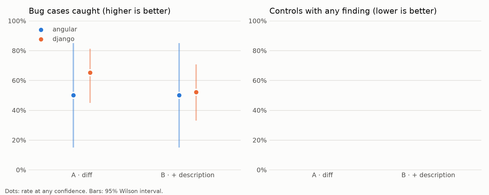
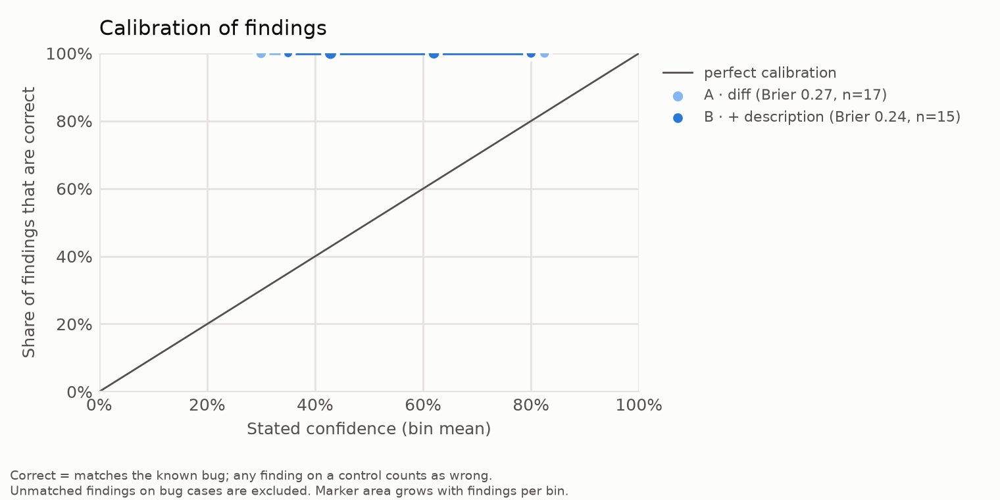

# Results: claude-sonnet-5-5_effort-high_scaleup_s2

## Detection rate (bug cases)

| repo/condition | conf ≥ 0.0 | conf ≥ 0.5 | conf ≥ 0.8 |
|---|---|---|---|
| all/A | 63% (17/27, CI 44%–78%) | 33% (9/27, CI 19%–52%) | 7% (2/27, CI 2%–23%) |
| all/B | 52% (14/27, CI 34%–69%) | 33% (9/27, CI 19%–52%) | 7% (2/27, CI 2%–23%) |
| angular/A | 50% (2/4, CI 15%–85%) | 50% (2/4, CI 15%–85%) | 0% (0/4, CI 0%–49%) |
| angular/B | 50% (2/4, CI 15%–85%) | 50% (2/4, CI 15%–85%) | 0% (0/4, CI 0%–49%) |
| django/A | 65% (15/23, CI 45%–81%) | 30% (7/23, CI 16%–51%) | 9% (2/23, CI 2%–27%) |
| django/B | 52% (12/23, CI 33%–71%) | 30% (7/23, CI 16%–51%) | 9% (2/23, CI 2%–27%) |

## False-alarm rate (controls)

| repo/condition | conf ≥ 0.0 | conf ≥ 0.5 | conf ≥ 0.8 |
|---|---|---|---|
| all/A | n/a | n/a | n/a |
| all/B | n/a | n/a | n/a |
| angular/A | n/a | n/a | n/a |
| angular/B | n/a | n/a | n/a |
| django/A | n/a | n/a | n/a |
| django/B | n/a | n/a | n/a |

## By merge date (all repos, any confidence)

| era/condition | detection | false alarms |
|---|---|---|
| merged 2024+/A | 63% (17/27, CI 44%–78%) | n/a |
| merged 2024+/B | 52% (14/27, CI 34%–69%) | n/a |

## Calibration (all repos)

| condition | findings | Brier | bins (mean conf → accuracy, n) |
|---|---|---|---|
| A | 17 | 0.269 | 0.30→1.00 (3); 0.43→1.00 (7); 0.62→1.00 (5); 0.82→1.00 (2) |
| B | 15 | 0.236 | 0.35→1.00 (1); 0.43→1.00 (7); 0.62→1.00 (5); 0.80→1.00 (2) |

Cases excluded after the run: angular/bug-62083

Failed reviews (excluded): 0

Spend recorded in this run: $2.38

## Charts

