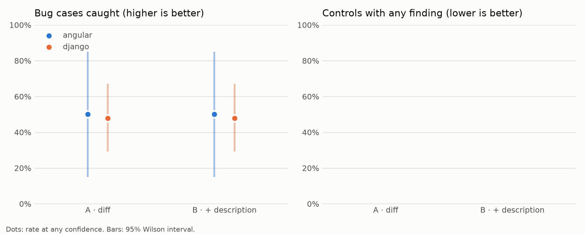
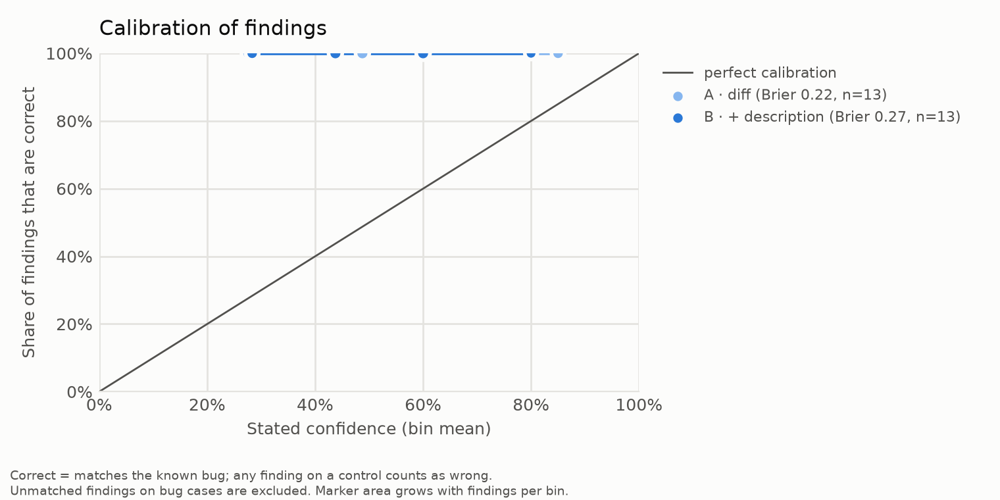

# Results: claude-sonnet-5-5_effort-high_scaleup_s3

## Detection rate (bug cases)

| repo/condition | conf ≥ 0.0 | conf ≥ 0.5 | conf ≥ 0.8 |
|---|---|---|---|
| all/A | 48% (13/27, CI 31%–66%) | 37% (10/27, CI 22%–56%) | 11% (3/27, CI 4%–28%) |
| all/B | 48% (13/27, CI 31%–66%) | 26% (7/27, CI 13%–45%) | 7% (2/27, CI 2%–23%) |
| angular/A | 50% (2/4, CI 15%–85%) | 50% (2/4, CI 15%–85%) | 0% (0/4, CI 0%–49%) |
| angular/B | 50% (2/4, CI 15%–85%) | 50% (2/4, CI 15%–85%) | 0% (0/4, CI 0%–49%) |
| django/A | 48% (11/23, CI 29%–67%) | 35% (8/23, CI 19%–55%) | 13% (3/23, CI 5%–32%) |
| django/B | 48% (11/23, CI 29%–67%) | 22% (5/23, CI 10%–42%) | 9% (2/23, CI 2%–27%) |

## False-alarm rate (controls)

| repo/condition | conf ≥ 0.0 | conf ≥ 0.5 | conf ≥ 0.8 |
|---|---|---|---|
| all/A | n/a | n/a | n/a |
| all/B | n/a | n/a | n/a |
| angular/A | n/a | n/a | n/a |
| angular/B | n/a | n/a | n/a |
| django/A | n/a | n/a | n/a |
| django/B | n/a | n/a | n/a |

## By merge date (all repos, any confidence)

| era/condition | detection | false alarms |
|---|---|---|
| merged 2024+/A | 48% (13/27, CI 31%–66%) | n/a |
| merged 2024+/B | 48% (13/27, CI 31%–66%) | n/a |

## Calibration (all repos)

| condition | findings | Brier | bins (mean conf → accuracy, n) |
|---|---|---|---|
| A | 13 | 0.218 | 0.28→1.00 (2); 0.49→1.00 (4); 0.60→1.00 (4); 0.85→1.00 (3) |
| B | 13 | 0.273 | 0.28→1.00 (3); 0.44→1.00 (4); 0.60→1.00 (4); 0.80→1.00 (2) |

Cases excluded after the run: angular/bug-62083

Failed reviews (excluded): 0

Spend recorded in this run: $2.29

## Charts

